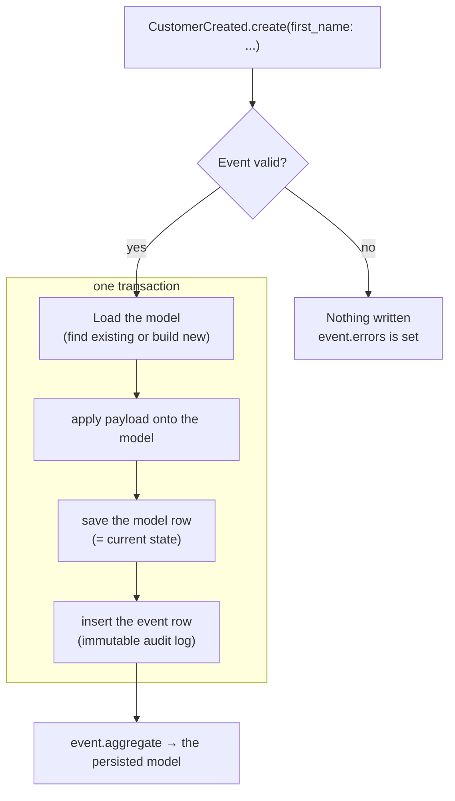

# RailsMicroEventSourcing

[](https://github.com/dbackowski/rails_micro_event_sourcing/actions/workflows/ci.yml)

The smallest event sourcing you can get away with in Rails: **the event _is_ the model.**

You write one ActiveRecord class per event. It declares which model it changes
(`aggregate_class`), what it carries (`event_attributes`), and its own validations.
Creating it validates the event, applies the change to the related model, and stores
the event — atomically, in one transaction.

There are no commands, no command handlers, no registry, no result objects, no event
bus, no snapshots, no schema versioning, and no web UI. The model row is the current
state; events are an append-only **audit log**, never replayed.

If you want the fuller-featured sibling (commands, handlers, subscriptions, snapshots,
schema versioning, an events viewer), use
[rails_simple_event_sourcing](https://github.com/dbackowski/rails_simple_event_sourcing).
This gem is the deliberately stripped-down version.

## How it works

Creating an event is the whole write path. Validation, the change to your model, and
the audit row all happen in one transaction — if the event is invalid, nothing is
touched.



The model row is the source of truth; the event row is a permanent record of what
changed. Events are never replayed.

## How it compares

| | `rails_simple_event_sourcing` | `rails_micro_event_sourcing` |
|---|---|---|
| Write path | Command → Handler → Event | **Event only** |
| Validation | on Commands | **on Events** (`ActiveModel::Errors`) |
| Reconstruction | replays events (+ snapshots) | **model row is the state** (no replay) |
| Event bus / subscribers | ✅ | ❌ (use `after_commit`) |
| Snapshots / schema versioning | ✅ | ❌ |
| Events viewer (web UI) | ✅ | ❌ |
| Read-only aggregates | always on | **opt-in per model** |
| Metadata tracking | ✅ | ✅ |

## Requirements

- Ruby >= 3.2
- Rails >= 7.1
- PostgreSQL (uses `jsonb` for payload/metadata)

## Installation

```ruby
# Gemfile
gem "rails_micro_event_sourcing"
```

```bash
bundle install
bin/rails rails_micro_event_sourcing:install:migrations
bin/rails db:migrate
```

This creates the `rails_micro_event_sourcing_events` table. No columns are added to
your own tables.

## Usage

### 1. Make a model an aggregate

```ruby
class Customer < ApplicationRecord
  include RailsMicroEventSourcing::Eventable
end
```

This adds `customer.events`. By default the model still accepts direct writes — the
gem is additive. To make events the *only* way to change it:

```ruby
class Customer < ApplicationRecord
  include RailsMicroEventSourcing::Eventable
  enforce_events_only! # direct writes now raise ActiveRecord::ReadOnlyRecord
end
```

#### What the guard does and doesn't cover

`enforce_events_only!` guards against accidental writes through ordinary ActiveRecord
calls. It is not a security boundary. It works through `readonly?`, so it stops the
basic record operations:

- `create` / `create!` / `save` / `update` / `update!`
- `update_attribute` / `update_column` / `update_columns` / `toggle!` / `touch`
- `destroy` / `destroy!` / `destroy_all` / `destroy_by`

Anything that doesn't consult `readonly?` is not covered:

- relation-level SQL (`update_all`, `insert_all`, `upsert_all`, `delete_all`,
  `delete_by`, `touch_all`) — a data migration doing `Customer.where(…).update_all(…)`
  rewrites state with no event and no error
- counter updates (`increment!`, `decrement!`, `update_counters`, counter caches)
- `customer.delete`
- another model class mapped to the same table
- raw SQL

`enable_write_access!` lifts the guard on one record, for data repairs. Writes through
it leave no event.

One ordinary pattern stops working: a child with `belongs_to :customer, touch: true`.
Rails touches the parent when the child's transaction commits, the touch is refused, and
the child is not saved. Remove `touch: true` from associations that point at an
enforced model.

To remove an enforced record, see [Deleting an aggregate](#deleting-an-aggregate).

The gem doesn't try to close the rest, and deliberately so: chasing every way Ruby can
reach a table means fighting ActiveRecord, and it still wouldn't stop a `psql` session.
If you want a real guarantee, the database already has one. The events table is
insert-only by design, so a grant says exactly that — no trigger, no gem code:

```sql
GRANT INSERT, SELECT ON rails_micro_event_sourcing_events TO your_app_role;
-- no UPDATE, no DELETE: the audit log is append-only at the database level
```

Your own tables get no equivalent — the gem itself has to `UPDATE` them when applying
an event.

### 2. Write an event

One class is the whole vertical slice — what changes, the rules, and the data:

```ruby
class Customer
  module Events
    class CustomerCreated < RailsMicroEventSourcing::Event
      aggregate_class Customer                       # which model it changes
      event_attributes :first_name, :last_name, :email  # what it carries

      validates :first_name, :last_name, :email, presence: true # its own rules
    end
  end
end
```

Every `event_attributes` value is copied onto the aggregate, so each name **must**
match a setter on the aggregate. If it doesn't, applying the event raises
`ArgumentError` (naming the offending attribute) instead of silently dropping the
value — a mistyped or renamed attribute fails loudly rather than writing a blank column.

Override `apply(aggregate)` when you need to normalize or derive a value. Call `super`
to copy the rest:

```ruby
event_attributes :first_name, :last_name, :email

def apply(aggregate)
  super
  aggregate.email = aggregate.email.strip.downcase
end
```

(Data that isn't part of the aggregate — request context, an audit flag — belongs in
[`metadata`](#metadata), not in `event_attributes`.)

### 3. Create it

```ruby
event = Customer::Events::CustomerCreated.create(
  first_name: "Jane", last_name: "Doe", email: "jane@example.com"
)

event.persisted?  # => true when valid
event.aggregate   # => the persisted Customer
event.errors      # => standard ActiveModel::Errors when invalid
```

`create` (or `create!`/`new` + `save`) does both things in one transaction:
- valid → the `Customer` is created/updated **and** the event row is written.
- invalid → nothing is written; the model is never touched.

Validations usually live on the event, but if the aggregate model has its own
`ActiveModel` validations they are checked too, and any failures surface in
`event.errors` — so `event.save` returns `false` rather than blowing up. (A
database constraint with no matching validation, e.g. a bare unique index, still
raises `ActiveRecord::RecordNotUnique` exactly as it would in plain Rails.)

In a controller:

```ruby
def create
  event = Customer::Events::CustomerCreated.new(customer_params)

  if event.save
    render json: event.aggregate, status: :created
  else
    render json: { errors: event.errors }, status: :unprocessable_entity
  end
end
```

### Updates

Pass `aggregate_id` to name the existing record. Only the attributes present in the
payload change — everything else on the row is left as-is.

```ruby
class Customer
  module Events
    class CustomerUpdated < RailsMicroEventSourcing::Event
      aggregate_class Customer
      event_attributes :first_name, :last_name, :email
    end
  end
end

Customer::Events::CustomerUpdated.create!(aggregate_id: customer.id, email: "new@example.com")
```

`aggregate_id` is virtual sugar — it is not a column. As input it names the record to
load; as output `event.aggregate_id` mirrors the linked id.

`aggregate_id:` is the *only* way to target a record with an event that has an
`aggregate_class`. Passing `eventable:` or building through the association
(`customer.events.create!(type: …)`) raises `ArgumentError` — those are for
[events without an aggregate](#events-without-an-aggregate). The rule in one line:
**events that change a record take `aggregate_id:`; facts about a record take
`eventable:`.**

### Events without an aggregate

Omit `aggregate_class` to record a fact that doesn't change any model (audit entry,
failed attempt, etc.):

```ruby
class Customer
  module Events
    class CustomerLoginFailed < RailsMicroEventSourcing::Event
      event_attributes :email
    end
  end
end

Customer::Events::CustomerLoginFailed.create!(email: "jane@example.com")
```

To attach it to a record's history without changing the record, pass `eventable:`:

```ruby
Customer::Events::CustomerLoginFailed.create!(eventable: customer, email: customer.email)

customer.events  # => [..., #<Customer::Events::CustomerLoginFailed>]
```

Pass a *persisted* record. An unsaved one is autosaved by `belongs_to`, so the record
gets created with this fact as its first event and no creation event (on an
`enforce_events_only!` model that raises `ReadOnlyRecord` instead).

`aggregate_id:` doesn't work here — with no `aggregate_class` there's nothing to resolve
the id against, so it raises `ArgumentError` rather than silently dropping the link.

### Side effects

Keep validations and `apply` pure. Put side effects (emails, webhooks, external APIs)
in the controller after a successful save, or in an `after_commit` on the event:

```ruby
class CustomerCreated < RailsMicroEventSourcing::Event
  after_commit :send_welcome_email, on: :create

  private

  def send_welcome_email
    WelcomeMailer.with(email: email).deliver_later
  end
end
```

Callbacks that *change the event's data* are a different matter. The aggregate is built
and validated from the payload during validation, so the payload and `aggregate_id` are
fixed from that point on. Normalize in `before_validation`:

```ruby
class CustomerCreated < RailsMicroEventSourcing::Event
  before_validation { self.email = email&.strip&.downcase }
end
```

Doing the same in `before_save` or `before_create` raises `ArgumentError` — the audit row
would otherwise store the edited value while the model keeps the original.

### Metadata

Each event has a `metadata` JSON column. Set `CurrentRequest.metadata` and any events
created during that unit of work pick it up. `CurrentRequest` is backed by
`ActiveSupport::CurrentAttributes`, so it resets automatically between requests/jobs.

```ruby
class ApplicationController < ActionController::Base
  before_action do
    RailsMicroEventSourcing::CurrentRequest.metadata = {
      request_id: request.uuid,
      request_ip: request.ip,
      current_user_id: current_user&.id
    }
  end
end
```

You can also set `metadata` per event. It is taken as-is and `CurrentRequest` is *not*
consulted — it replaces the request context rather than adding to it, so merge yourself
if you want both:

```ruby
Customer::Events::CustomerCreated.create!(
  **attrs, metadata: { reason: "csv import" }
)                                       # => { "reason" => "csv import" }

Customer::Events::CustomerCreated.create!(
  **attrs, metadata: RailsMicroEventSourcing::CurrentRequest.metadata.merge(reason: "csv import")
)                                       # => { "request_id" => "…", "reason" => "csv import" }
```

`nil` is not the same as `{}` here. Passing `nil` (or nothing) falls back to
`CurrentRequest`; passing `{}` stores an empty hash and opts the event out of the request
context entirely — useful for a background job you don't want stamped with whatever
request happens to be in flight. An unset `CurrentRequest` stores `NULL`, so a `{}` in
the column means "explicitly nothing" and `NULL` means "nothing was set".

Don't declare `event_attributes :metadata`. It defines a `metadata` reader on the event
that returns the *payload* value, while the column keeps being stamped as usual — two
live values, no error. Same for any other column name (`payload`, `type`, `created_at`).

### Querying the audit log

```ruby
customer.events                                  # this aggregate's history, oldest first
customer.events.last.payload                     # the stored attributes
RailsMicroEventSourcing::Event.where(type: "Customer::Events::CustomerCreated")
```

Both of those are indexed — the migration ships an index on `type` and a composite on
`(eventable_type, eventable_id, created_at, id)`. Two common queries are not, and stay
sequential scans as the log grows:

```ruby
# searching inside the payload
RailsMicroEventSourcing::Event.where("payload @> ?", { email: "jane@example.com" }.to_json)

# a time range across all aggregates (created_at is not a leading index column)
RailsMicroEventSourcing::Event.where(created_at: 1.day.ago..)
```

Neither index ships by default, because both cost write throughput on every event and
most apps only ever read an aggregate's own history. Add them in your own migration if
you actually run those queries:

```ruby
add_index :rails_micro_event_sourcing_events, :payload, using: :gin
add_index :rails_micro_event_sourcing_events, :created_at
```

### Renaming or removing an event class

Each event row stores its full class name in `type`, and loading the row turns that name
back into the class. Rename an event class, move it to another namespace, or delete it,
and every row already written under the old name raises
`ActiveRecord::SubclassNotFound` when loaded. One such row is enough to break
`customer.events` for that record's whole history. Writes keep working, so it usually
surfaces later, on an audit page.

The rows can't be fixed in place: the log is append-only, and under the
[insert-only grant](#what-the-guard-does-and-doesnt-cover) an `UPDATE` of `type` is
refused. Keep the old name loadable instead.

To rename, keep the old name as an empty subclass of the new one. It inherits
`aggregate_class` and `event_attributes`, so old rows load with their readers intact:

```ruby
class Customer
  module Events
    class CustomerRegistered < RailsMicroEventSourcing::Event
      aggregate_class Customer
      event_attributes :first_name, :last_name, :email
    end

    # Rows written before the rename. Do not delete.
    class CustomerSignedUp < CustomerRegistered; end
  end
end
```

Put each class in its own file as usual (`customer_signed_up.rb` here), so autoloading
finds it.

To retire an event type, stop emitting it but keep its class.

With lazy loading (development, and tests without eager loading), Rails only knows the
subclasses it has already loaded. Until the old class is loaded,
`CustomerRegistered.where(…)` leaves out the rows stored under the old name;
`customer.events` is unaffected, because it doesn't filter by type.

## Backfilling existing records

When you adopt the gem on a table that already has rows, those records have no
history. You can't magically reconstruct what happened before, but you *can* seed a
single genesis event per record so the audit log isn't blank — a snapshot of the
current state, stamped with the row's original `created_at`.

`backfill!` does exactly that. Unlike a normal event, it does **not** replay onto the
aggregate (the row already holds the correct state), so your records are left
untouched — no `updated_at` bump, no validations. It only appends the audit row:

```ruby
Customer.find_each do |customer|
  Customer::Events::CustomerCreated.backfill!(customer, metadata: { backfilled: true })
end
```

Each backfilled event:

- **stores a full snapshot** of the row in `payload` (every column, including
  `created_at`/`updated_at`), not just the declared `event_attributes` — so the last
  point in history you can honestly capture is preserved. The snapshot is read from the
  database, not from the object you pass, so unsaved changes on it are not captured.
- **backdates the event's `created_at`** to the record's original creation time, so
  `customer.events` orders it ahead of any real events created after adoption.
- is **idempotent**: it returns `nil` and writes nothing if the aggregate already has
  *any* event — a previous backfill, a real creation event, anything. The point is to
  seed a genesis row for a blank history, so a non-blank one is left alone. Re-run the
  task as many times as you like, including two runs at once: each backfill takes the
  same row lock an event takes, so overlapping runs go in turn and the second one finds
  the first one's row.

Because it's a reconstruction, tag it (`metadata: { backfilled: true }`) so synthetic
genesis events stay distinguishable from ones your app actually emitted. You have to
pass metadata by hand here: `backfill!` inserts the row directly and skips callbacks, so
unlike a normal event it never picks up `CurrentRequest.metadata`.

You can override the snapshot or timestamp explicitly:

```ruby
Customer::Events::CustomerCreated.backfill!(
  customer,
  payload: { first_name: customer.first_name, email: customer.email }, # custom snapshot
  created_at: customer.created_at,
  metadata: { backfilled: true }
)
```

`backfill!` raises `ArgumentError`, writing nothing, when:

- the event class has no `aggregate_class` (aggregate-less events record facts, not
  records, so there's nothing to seed);
- the record isn't an instance of the event's `aggregate_class` — a genesis row can't
  be taken back, and a wrong one would block the right backfill for good;
- the `aggregate_class` doesn't include `RailsMicroEventSourcing::Eventable`;
- the record isn't persisted yet (it has no id to attach the audit row to).

Records hidden by a `default_scope` (discard, acts_as_paranoid) can be backfilled: pass
them in, e.g. from `Customer.unscoped.find_each`.

## Removing the gem

Because state lives in your own columns, removal is clean: drop the `include`, delete
your event classes, and drop the events table. Your model keeps working as plain
ActiveRecord. Delete the classes only together with the table: while the log is kept,
every class that has rows in it must stay (see
[Renaming or removing an event class](#renaming-or-removing-an-event-class)).

## Deleting an aggregate

A deletion is a fact worth recording, so the recommended way to remove a record is an
event that marks it deleted. It needs no special support — it is an ordinary update
event carrying a timestamp column you add to your table:

```ruby
class Customer
  module Events
    class CustomerDeleted < RailsMicroEventSourcing::Event
      aggregate_class Customer
      event_attributes :deleted_at
    end
  end
end

Customer::Events::CustomerDeleted.create!(aggregate_id: customer.id, deleted_at: Time.current)
```

The row stays, its history stays linked, and the deletion itself is in the log with its
[metadata](#metadata) — who did it and when. Hiding deleted rows from queries is up to
you (a scope such as `where(deleted_at: nil)`).

On an `enforce_events_only!` model this is the *only* route: `destroy` raises
`ActiveRecord::ReadOnlyRecord` like any other direct write. `customer.delete` still
goes through, as [the guard section](#what-the-guard-does-and-doesnt-cover) says, but
it leaves no event behind.

### Hard deletes

On a model without `enforce_events_only!`, `destroy` works as in plain Rails, and it
never touches the record's events. The `events` association has no `dependent:`
option, so the audit rows stay exactly as written and keep the `eventable_type` /
`eventable_id` they were stored with:

```ruby
customer.destroy

event = RailsMicroEventSourcing::Event.find_by(eventable_type: "Customer", eventable_id: customer.id)
event.eventable     # => nil — the record is gone
event.aggregate_id  # => the id it had, so its history is still queryable
```

There is no foreign key on the events table, so nothing blocks the delete, and the
insert-only grant [above](#what-the-guard-does-and-doesnt-cover) keeps working — the
gem itself never issues an `UPDATE` or `DELETE` against the log.

## Concurrency

Updates to the same aggregate are serialized with `SELECT ... FOR UPDATE` while the
event is created, so concurrent writers to one aggregate are applied in order.

## License

[MIT](MIT-LICENSE).
